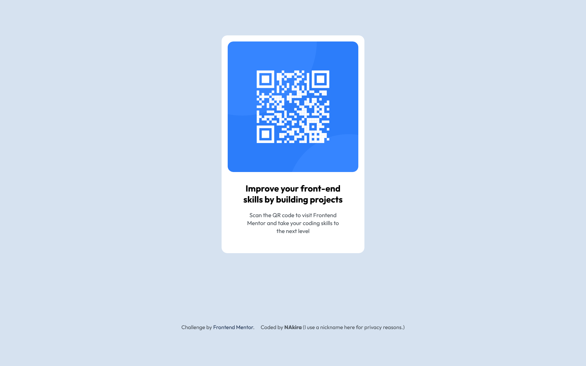

# QR Code Component

## Table of contents

- [Overview](#overview)
  - [Screenshot](#screenshot)
  - [Links](#links)
- [My process](#my-process)
  - [Built with](#built-with)
  - [Continued development](#continued-development)
  - [Useful resources](#useful-resources)
  - [AI Collaboration](#ai-collaboration)
- [Author](#author)

## Overview

A QR code component built with HTML and CSS.

### Screenshot

### Links

- Solution URL: [Add your solution URL](https://your-solution-url.com)
- Live site URL: [Add your live site URL](https://your-live-site-url.com)

## My process

- I initialized an empty repository and configured my Git username and email.

- I read the Markdown files and reviewed the design images.

- I structured the HTML using semantic elements.

- I linked the CSS file and loaded the font required for the page.

- I created a small design system with CSS custom properties. This was helpful because I didn't have to search for the "right" values as I styled the page.

- I added a global reset after defining my design tokens. Next time, I would add it earlier in the process.

- I added basic styles, including the font size and font family.

- I centered the component using CSS Grid.

- I added the colors, including the background color.

- I added spacing. At first, I used more whitespace than I needed to make it easier to style the layout and its contents.

- I added padding and used Flexbox to arrange the content and create gaps.

- I added rounded corners.

- I refined the spacing.

- I styled the footer.

While working on the project, I used Git Bash and Chrome DevTools.

### Built with

- Semantic HTML5 markup
- CSS custom properties
- Flexbox
- CSS Grid
- Desktop-first workflow

### Continued development

Using CSS custom properties helped me learn about design tokens. I also learned that setting the root font size to 62.5% can cause accessibility issues and may lead to problems when using UI libraries. I defined spacing and typography values in `:root` using `rem` units and a 4px scale with 2px half-steps. I plan to keep refining this system in future projects. (p stands for plus which means add the specified number after the product for the half-steps.)

### Useful resources

[Open Color](https://yeun.github.io/open-color/) - This helped me choose colors without spending too much time deciding which ones to use. Alternatives such as Coolors can also generate color palettes.

[Google Fonts](https://fonts.google.com/) - I used this to find and load the font for the page.

[DeepSeek](https://deepseek.com/) - I used this to learn Git Bash commands, write Markdown, and use Chrome DevTools more effectively. In my opinion, it is one of the best AI tools available, especially because its free version is accessible to regular users. I found Gemini's free version less reliable for my needs.

### AI Collaboration

- I used DeepSeek and GitHub Copilot.

- I mostly used DeepSeek for Git Bash questions, such as understanding commands and finding a way to edit a commit message. I recently started learning Git Bash and am slowly getting familiar with it.

- I used GitHub Copilot to proofread this README and analyze my code.

## Author

- Frontend Mentor - [@yourusername](https://www.frontendmentor.io/profile/yourusername)
